# AIGuard Framework

[](https://github.com/YashkantG/AIGuard-Framework/actions/workflows/ci.yml)
[](LICENSE)

AIGuard helps you trust the machine learning models you deploy. It answers five questions about a model:

1. **Is the file safe to load?** It scans model files for hidden code without running them.
2. **Has the file changed?** It fingerprints each model and detects any modification.
3. **Has the data changed?** It detects drift between training data and current data.
4. **Why does it predict what it predicts?** It shows which features matter most.
5. **Is it ready for production?** It checks your governance rules and keeps a tamper-evident audit log.

Status: alpha (0.1.0).

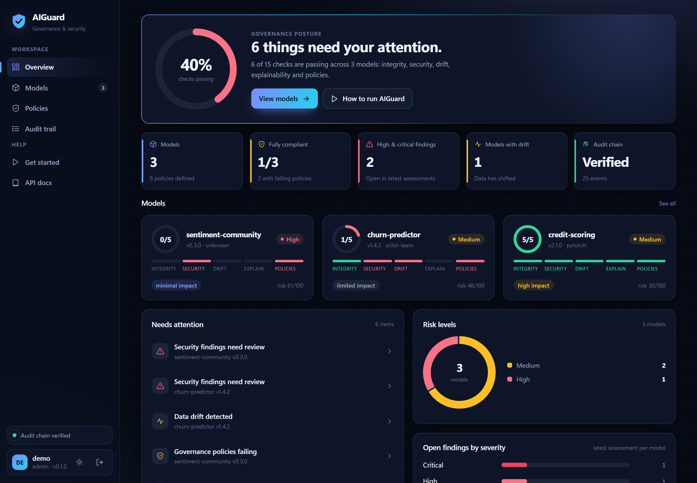

## Install

Requires Python 3.12 or newer.

```bash
git clone https://github.com/YashkantG/AIGuard-Framework.git
cd AIGuard-Framework
pip install -e ".[dev]"
```

## Try the dashboard

```bash
aiguard seed-demo
aiguard serve
```

Open http://127.0.0.1:8000 and paste the admin key that `aiguard serve` prints. You will see three sample models: one healthy, one with data drift, and one with a dangerous file.

The **Get started** page inside the dashboard shows these steps, plus copy-ready commands for the command line, Python, the REST API and deployment.

## What the dashboard looks like

**1. Sign in** with the key printed by `aiguard serve`.

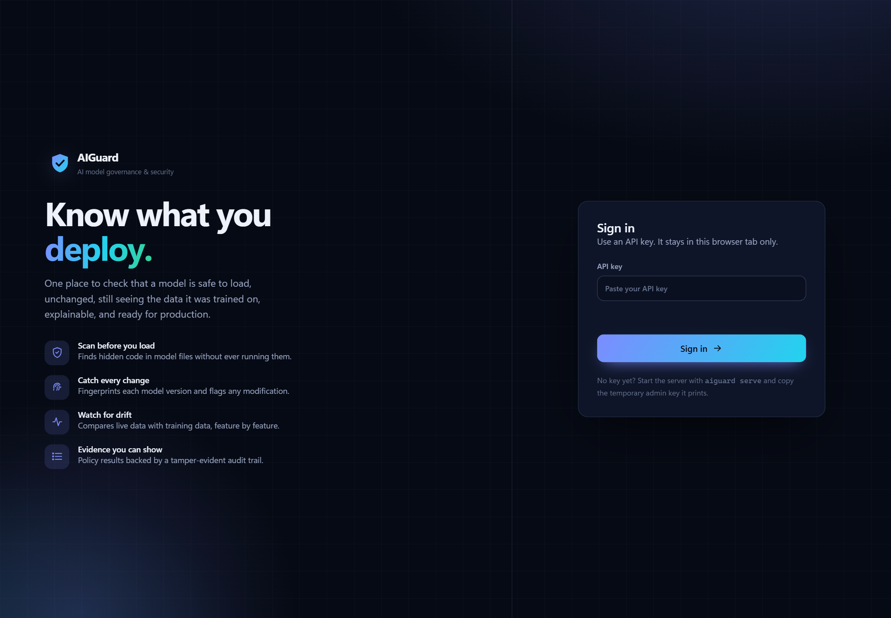

**2. Overview** shows how many checks pass across all models and what needs attention. A light theme is one click away.

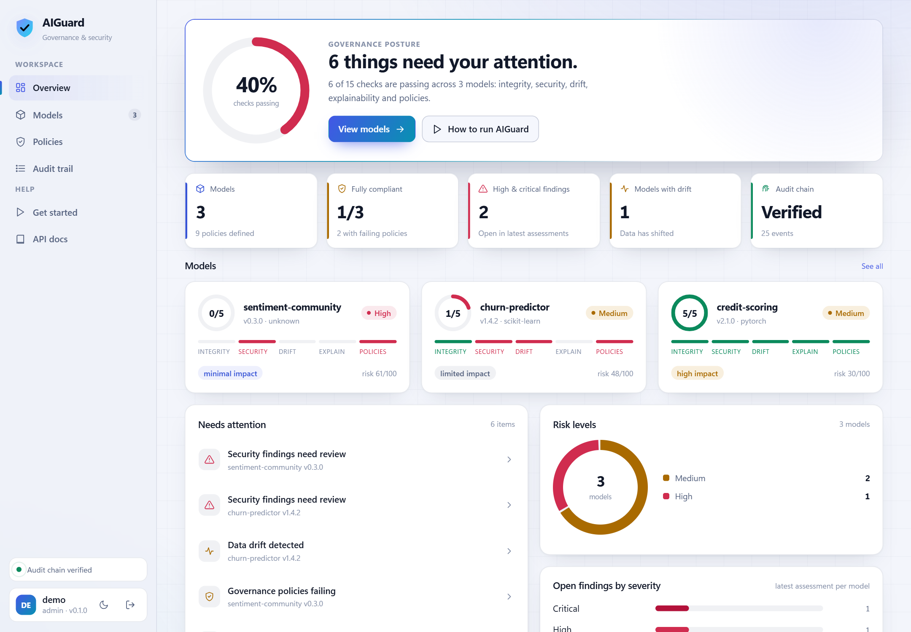

**3. Models** lists every model with its integrity, security, drift, policy and risk status.

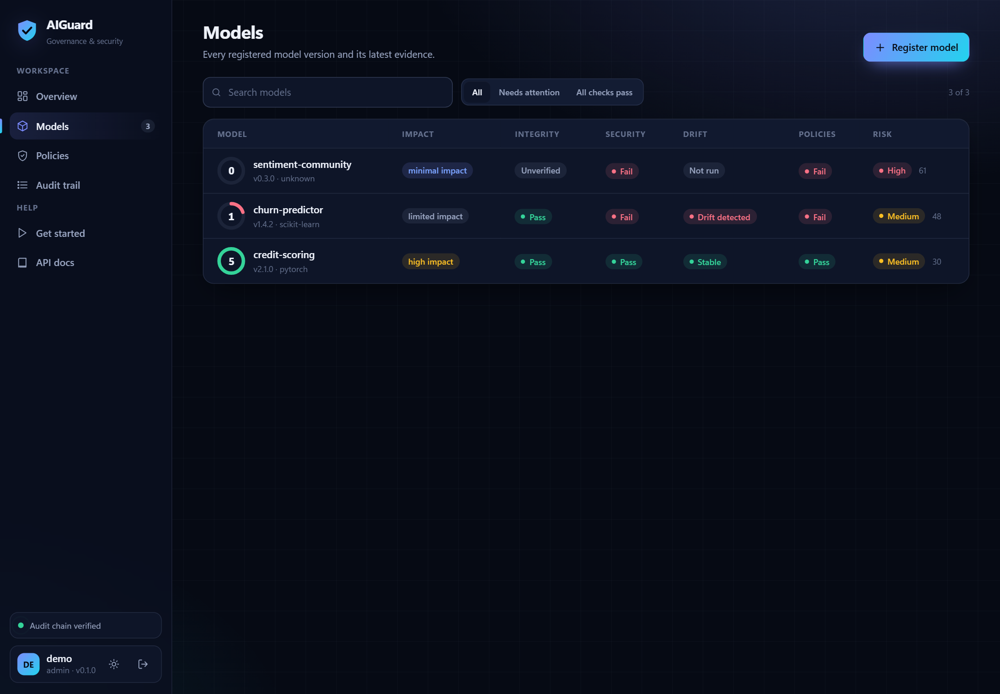

**4. A model page** shows its five checks and risk score. Press **Run all checks** to verify, scan, score and evaluate it in one go.

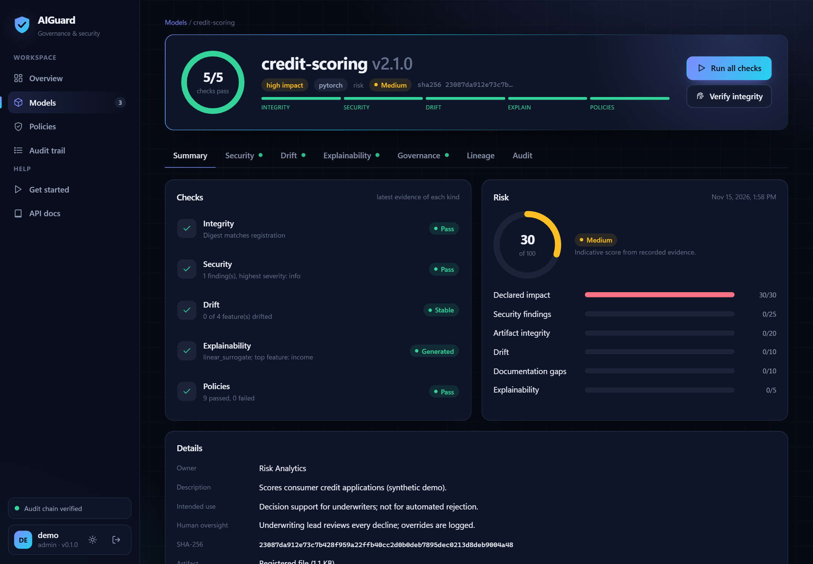

**5. Security** lists what the scanner found in the model file and how to fix it.

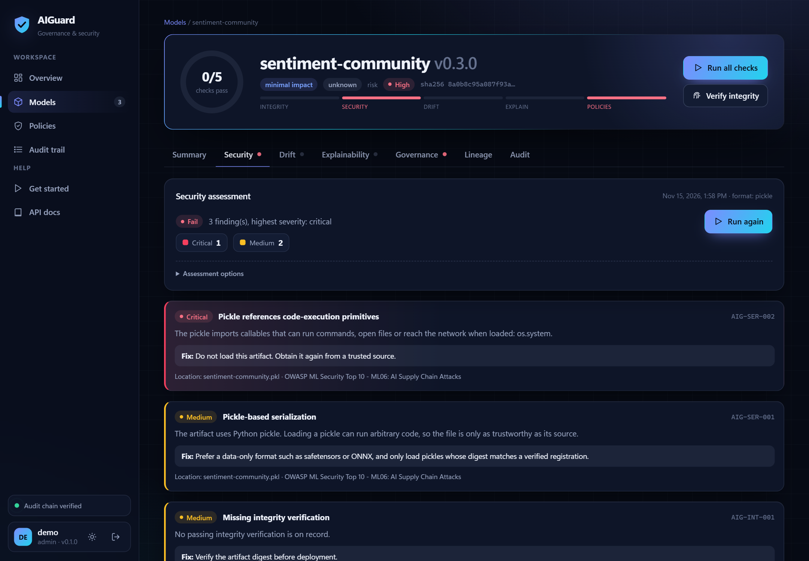

**6. Drift** shows which features have shifted since training.

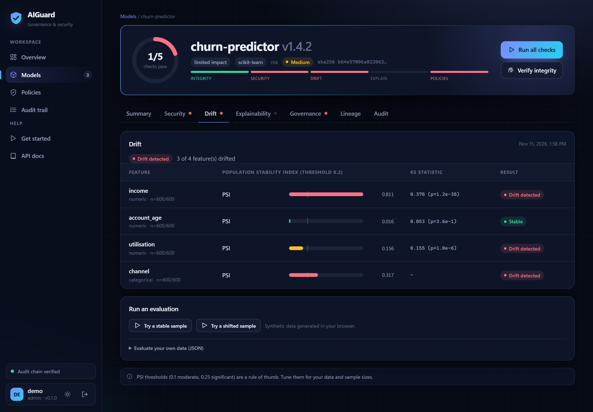

**7. Explainability** shows which features drive the model's output.

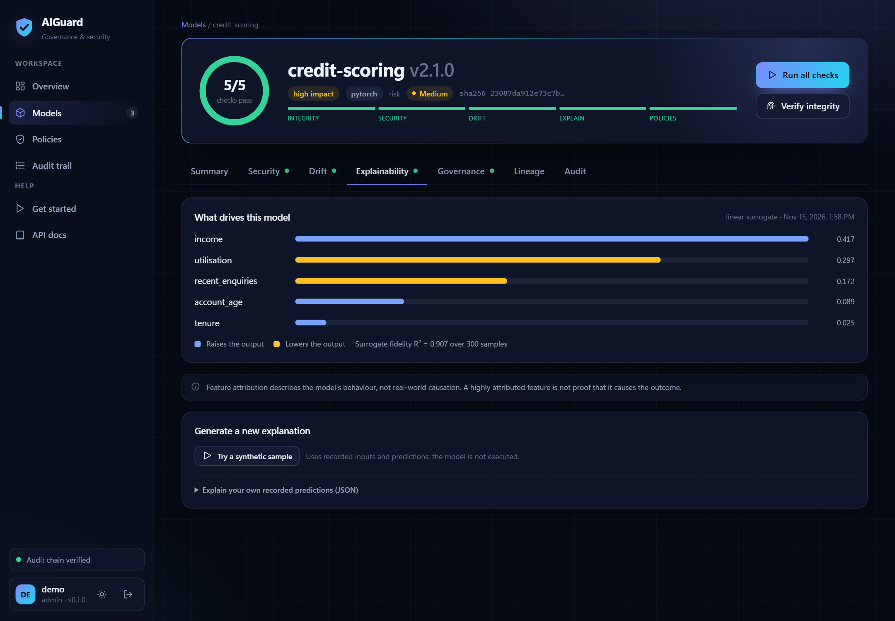

**8. Governance** shows each policy, whether it passes, and the evidence behind it.

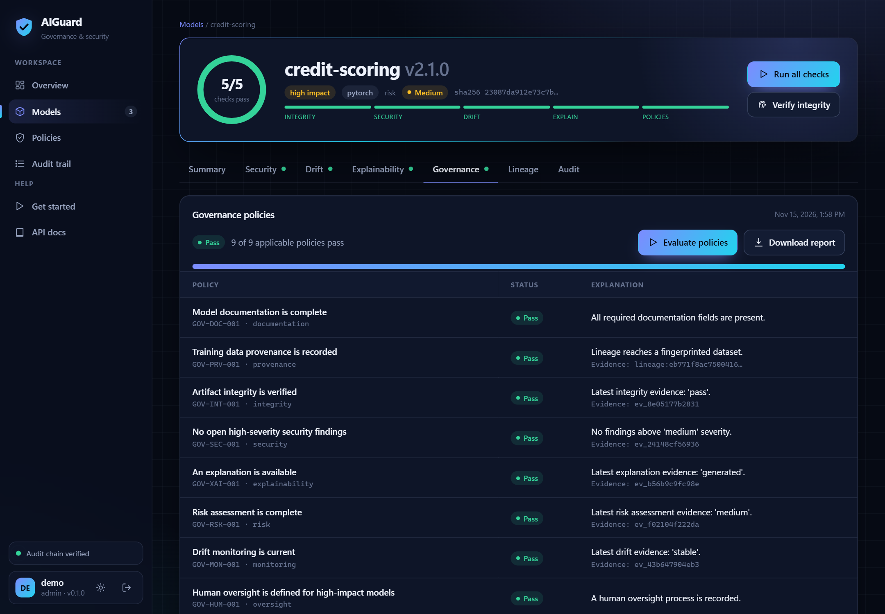

**9. Lineage** traces the model back to its training data.

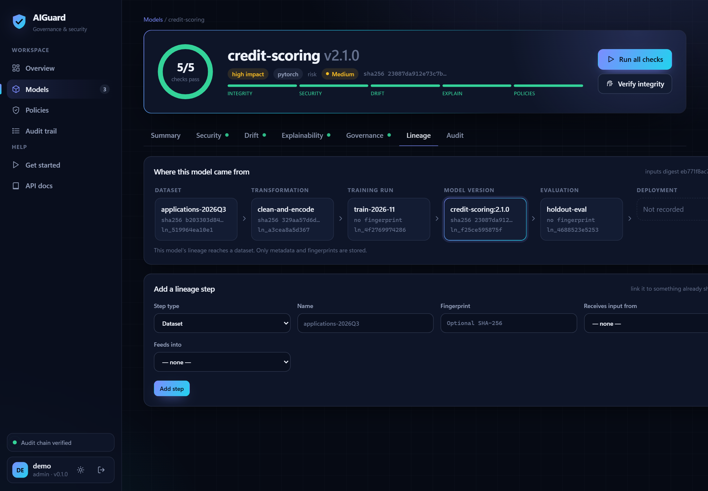

**10. Get started** has step-by-step instructions with copy buttons.

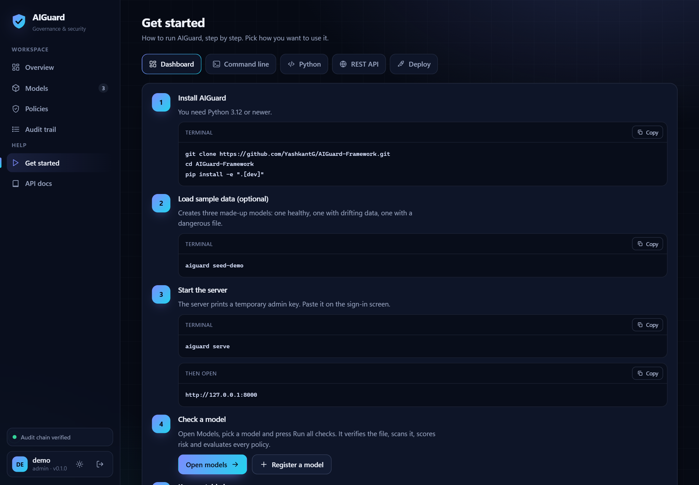

All screenshots use made-up demo data.

## Example: is this model file safe?

```python
from aiguard.security import scan_artifact

result = scan_artifact("downloaded_model.pkl")
for finding in result["findings"]:
    print(finding.severity, "-", finding.title)
```

For a file that hides a shell command, this prints:

```text
medium - Pickle-based serialization
critical - Pickle references code-execution primitives
```

The same check from the command line:

```bash
aiguard scan downloaded_model.pkl
```

## Example: has my model file changed?

```python
from aiguard import AIGuard
from aiguard.core.models import ModelCreate

guard = AIGuard()
model = guard.register_model(
    ModelCreate(name="spam-filter", version="1.0.0", artifact_path="model.bin")
)

guard.verify_integrity(model["id"])["verified"]   # True
# ... someone edits model.bin ...
guard.verify_integrity(model["id"])["verified"]   # False
```

Model files go in the `artifacts` folder next to where you run the code.

## Example: has my data drifted?

```python
from aiguard.monitoring import detect_drift

report = detect_drift({
    "income": {"reference": training_income, "current": this_month_income},
})
print(report["drifted_features"])   # ['income']
```

## More examples

Each of these runs on its own with made-up data:

| Run this | What it shows |
|---|---|
| `python examples/01_scan_model_file.py` | Scanning a safe file and a dangerous one |
| `python examples/02_detect_drift.py` | Finding which features have drifted |
| `python examples/03_register_and_check.py` | Registering a model, catching a modified file, checking policies |
| `python examples/04_full_lifecycle.py` | Everything together on a real scikit-learn model |

## Command line

```bash
aiguard scan model.pkl                  # is the file safe?
aiguard register fraud 1.0.0 model.pkl  # record the model
aiguard verify <model-id>               # has it changed?
aiguard assess <model-id>               # security assessment
aiguard gate <model-id>                 # do all policies pass?
aiguard report <model-id>               # evidence report
```

## Use it as an AI agent skill

[`skills/model-file-scanner`](skills/model-file-scanner) packages the model file scanner as a skill for AI coding agents. It is a `SKILL.md` plus one Python script with no dependencies, so an agent can check a model file before loading it:

```bash
python skills/model-file-scanner/scripts/scan_model.py downloaded_model.pkl
```

## Learn more

- [Configuration and deployment](docs/configuration.md)
- [REST API reference](docs/api-reference.md)
- [Governance policies](docs/governance.md)
- [Security model](docs/security-model.md) and [threat model](docs/threat-model.md)
- [Architecture and design](docs/architecture.md)

## What AIGuard does not do

- It does not prove a model is secure or unbiased. It reports what it finds.
- It does not guarantee regulatory compliance or provide certification.
- A clean scan means no known problem was found, not that none exists.

## Contributing

See [CONTRIBUTING.md](CONTRIBUTING.md). Report security problems privately as described in [SECURITY.md](SECURITY.md).

## License

Apache License 2.0. See [LICENSE](LICENSE).

AIGuard is an independent open-source project built with public and synthetic data only. No employer affiliation, endorsement or ownership is implied.
